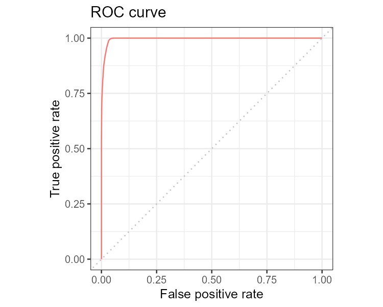
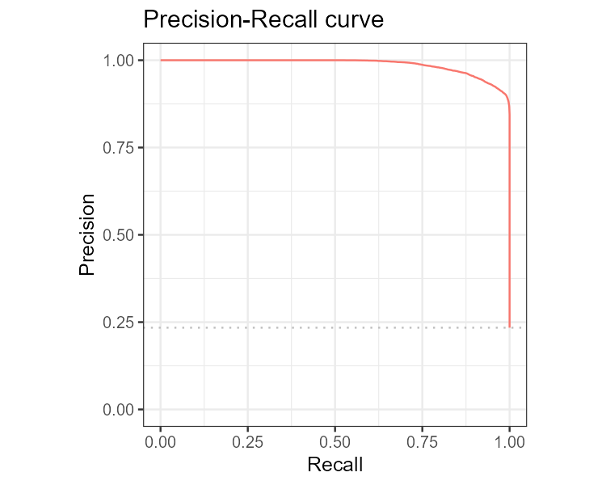

# m6APrediction

`m6APrediction` predicts whether a candidate RNA site is an **N6-methyladenosine (m6A)**
modification site. A pre-trained random forest classifier takes transcriptomic features
(GC content, RNA type, RNA region, exon length, distance to the nearest splice junction,
evolutionary conservation, and a DNA 5-mer) and returns both the probability of being
modified and a binary `Positive` / `Negative` call.

## Installation

Install the package directly from GitHub with either `devtools` or `remotes`:

```r
if (!requireNamespace("devtools", quietly = TRUE)) install.packages("devtools")
devtools::install_github("468636/m6APrediction")
```

```r
if (!requireNamespace("remotes", quietly = TRUE)) install.packages("remotes")
remotes::install_github("468636/m6APrediction")
```

## Usage

Load the package and the bundled random forest model first:

```r
library(m6APrediction)
rf_fit <- load_rf_model()
```

### Predict multiple sites from a feature table

```r
example_df <- read.csv(
  system.file("extdata", "m6A_input_example.csv",
              package = "m6APrediction"),
  stringsAsFactors = FALSE
)

prediction_multiple(rf_fit, example_df)
```

The returned table gains two columns: `predicted_m6A_prob` (probability of being
modified) and `predicted_m6A_status` (`Positive` or `Negative`).

### Predict a single site from individual features

```r
prediction_single(
  rf_fit,
  gc_content = 0.66,
  RNA_type = "lncRNA",
  RNA_region = "intron",
  exon_length = 0,
  distance_to_junction = 10.67,
  evolutionary_conservation = 0.016,
  DNA_5mer = "GGACC"
)
```

## Model performance

The random forest was evaluated on the m6A feature dataset. The ROC and precision-recall
curves below summarise its discrimination performance.





- AUC ROC: **0.996**
- AUC PRC: **0.988**

## Features used

| Feature | Description |
|---|---|
| `gc_content` | GC content of the surrounding region (0–1) |
| `RNA_type` | mRNA, lincRNA, lncRNA, pseudogene |
| `RNA_region` | CDS, intron, 3'UTR, 5'UTR |
| `exon_length` | Exon length feature |
| `distance_to_junction` | Distance to the nearest splice junction |
| `evolutionary_conservation` | Conservation score (0–1) |
| `DNA_5mer` | 5-mer sequence around the candidate adenosine (A/T/C/G) |

## License

This package is released under the MIT license.
